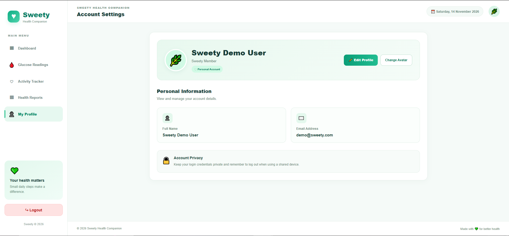

# 💚 Sweety – Blood Glucose Tracker

A full-stack blood glucose monitoring web application developed for the **Kenpath Junior Full Stack Developer – JavaScript & AI Technical Assignment**.


---

## 1. Project Overview

Sweety is a responsive health companion application that allows users to securely record, manage, and review up to four blood glucose readings per day.

The application provides daily, month-to-date, previous-month, and custom date range reports with interactive visualizations.

### Project Objectives

- Simplify daily blood glucose tracking.
- Provide secure and user-specific data management.
- Display meaningful glucose statistics.
- Provide a responsive and user-friendly experience.
- Maintain data accuracy through frontend, backend, and database validation.

---

## 2. Technology Stack

| Category | Technologies |
|----------|--------------|
| Frontend | React.js, Vite, JavaScript, HTML5, CSS3 |
| Backend | Node.js, Express.js |
| Database | PostgreSQL |
| Authentication | JWT, bcrypt |
| Data Visualization | Recharts |
| API | REST API |
| Version Control | Git, GitHub |
| Development Environment | Visual Studio Code |

---

## 3. Features

### User Authentication

- User registration using name, email, and password.
- Login using registered credentials.
- Password hashing using bcrypt.
- JWT-based authentication.
- Protected API endpoints.
- User-specific glucose records.
- Password reset functionality.
- Logout confirmation dialog.

### Glucose Reading Management

- Add new blood glucose readings.
- View recorded glucose measurements.
- Edit existing readings.
- Delete readings.
- Record measurement dates and times.
- Filter reading history using From Date and To Date.
- Paginated reading history with five records per page.
- Daily reading completion indicator.

### Supported Time Slots

1. Morning (fasting)
2. After breakfast
3. After lunch
4. After dinner

### Validation Rules

- Glucose value is required.
- Glucose value must be a whole number.
- Accepted glucose values range from 40 to 600 mg/dL.
- Only one reading per time slot per day is allowed.
- A maximum of four readings per day is allowed.
- Future measurement dates and times are not allowed.
- The measurement date must match the selected reading date.
- Invalid reading IDs are rejected.
- Duplicate readings are prevented.
- Friendly validation messages are displayed.
- Validation is implemented on both the frontend and backend.
- Database constraints provide additional data integrity.

The accepted input range is an application validation rule and does not represent a medically recommended glucose range.

---

## 4. Reports and Analytics

Sweety provides four report types.

### Daily Report

Displays all glucose readings recorded on the selected date.

Includes:

- Total readings.
- Highest glucose value.
- Lowest glucose value.
- Average glucose value.
- Individual readings with their time slots.
- Daily reading completion indicator.
- Glucose trend visualization.

### Month-to-Date Report

Displays readings from the first day of the selected month through the selected date.

Includes:

- Total readings.
- Highest glucose value.
- Lowest glucose value.
- Average glucose value.
- Glucose trend visualization.
- Paginated reading details.

### Previous Month Report

Displays readings recorded during the entire previous calendar month.

Includes:

- Total readings.
- Highest glucose value.
- Lowest glucose value.
- Average glucose value.
- Glucose trend visualization.
- Paginated reading details.

### Custom Date Range Report

Allows users to select a specific reporting period using From Date and To Date.

Includes:

- Inclusive start and end dates.
- Future date restrictions.
- Date range validation.
- Automatically updated statistics.
- Glucose trend visualization.
- Paginated reading details.

### Example Report Periods

When the selected date is 15 October 2026:

| Report Type | Reporting Period |
|-------------|------------------|
| Daily Report | 15 October 2026 |
| Month-to-Date | 1–15 October 2026 |
| Previous Month | 1–30 September 2026 |
| Custom Date Range | User-selected start and end dates |

All average glucose values are displayed to one decimal place.

Statistics and charts are calculated using all readings within the selected reporting period, not just the currently displayed page.

All reports display friendly empty-state messages when no readings are available.

---

## 5. Additional Features

### Interactive Glucose Visualization

- Responsive glucose trend charts using Recharts.
- Interactive tooltips.
- Measurement dates and glucose values.
- Recorded time slot information.
- Automatic chart resizing.
- Mobile-friendly chart layout.
- Friendly empty states.

### User Profile

- Personal profile details.
- Profile editing.
- Avatar customization.
- Responsive profile interface.

### Activity Tracker

- Personal activity tracking interface.
- Health companion functionality.
- Responsive activity dashboard.

### User Experience

- Clean and consistent health-themed interface.
- Responsive desktop and mobile layouts.
- Friendly inline validation messages.
- Success and error notifications.
- Automatic notification dismissal.
- Confirmation dialogs.
- Reading history pagination.
- Report pagination.
- Date range filters.

---

## 6. Project Architecture

The application follows a client-server architecture.

```text
+-----------------------------+
|       React Frontend        |
|  Dashboard, Forms, Reports  |
+--------------+--------------+
               |
               | HTTP / REST API
               | JWT Authentication
               |
+--------------v--------------+
|   Node.js / Express Backend |
|  Authentication, Validation |
|      Reading Management     |
+--------------+--------------+
               |
               | Parameterized SQL
               |
+--------------v--------------+
|     PostgreSQL Database     |
|   Users, Glucose Readings   |
+-----------------------------+
```

### Application Workflow

1. The user registers or logs in.
2. The backend validates the submitted credentials.
3. A JWT is issued after successful authentication.
4. The frontend sends authenticated API requests.
5. The backend validates requests and accesses PostgreSQL.
6. User-specific glucose records are returned.
7. The frontend displays readings, statistics, and charts.

Report filtering, statistics, and display pagination are performed on the authenticated user's retrieved readings.

---

## 7. Project Structure

```text
sweety-blood-glucose-tracker/
|
|-- backend/
|   |-- middleware/
|   |   |-- auth.js
|   |
|   |-- routes/
|   |   |-- authRoutes.js
|   |   |-- readingRoutes.js
|   |   |-- aiRoutes.js
|   |
|   |-- db.js
|   |-- server.js
|   |-- schema.sql
|   |-- seed.js
|   |-- .env.example
|   |-- .gitignore
|   |-- package.json
|   |-- package-lock.json
|
|-- frontend/
|   |-- public/
|   |
|   |-- src/
|   |   |-- assets/
|   |   |
|   |   |-- components/
|   |   |   |-- ActivityTracker.jsx
|   |   |   |-- ActivityTracker.css
|   |   |   |-- AuthPage.jsx
|   |   |   |-- AuthPage.css
|   |   |   |-- GlucoseChart.jsx
|   |   |   |-- HealthReports.jsx
|   |   |   |-- Profile.jsx
|   |   |   |-- ResetPassword.jsx
|   |   |
|   |   |-- services/
|   |   |   |-- readingService.js
|   |   |
|   |   |-- App.jsx
|   |   |-- App.css
|   |   |-- index.css
|   |   |-- main.jsx
|   |
|   |-- index.html
|   |-- vite.config.js
|   |-- .gitignore
|   |-- package.json
|   |-- package-lock.json
|
|-- screenshots/
|   |-- Login page.png
|   |-- Dashboard with glucose charts.png
|   |-- Glucose reading form and history.png
|   |-- Daily report.png
|   |-- monthly report.png
|   |-- Custom date range report.png
|   |-- Profile.png
|   |-- Activity tracker.png
|   |-- Mobile view.png
|
|-- .gitignore
|-- README.md
```

---

## 8. Installation and Setup

### Prerequisites

Ensure the following software is installed:

- Node.js compatible with the installed Vite version
- npm
- PostgreSQL
- Git

Visual Studio Code and pgAdmin are recommended for local development.

### Step 1: Clone the Repository

```bash
git clone https://github.com/venkat7855/sweety-blood-glucose-tracker.git
```

Navigate to the project directory:

```bash
cd sweety-blood-glucose-tracker
```

### Step 2: Install Backend Dependencies

```bash
cd backend
npm install
```

### Step 3: Configure Environment Variables

Create a `.env` file inside the backend directory using the provided `.env.example` template.

For Windows Command Prompt:

```cmd
copy .env.example .env
```

For Windows PowerShell:

```powershell
Copy-Item .env.example .env
```

For macOS or Linux:

```bash
cp .env.example .env
```

Update the `.env` file with your local PostgreSQL connection details, JWT secret, and other configuration values required by the template.

A random JWT secret can be generated using:

```bash
node -e "console.log(require('crypto').randomBytes(32).toString('hex'))"
```

Use the generated value for the JWT secret in your local environment configuration.

Never commit the actual `.env` file.

### Step 4: Set Up PostgreSQL Database

Open PostgreSQL using pgAdmin or the PostgreSQL command-line interface.

Create a database:

```sql
CREATE DATABASE sweety;
```

The database name must match the value configured in your `.env` file.

#### Using pgAdmin

1. Open pgAdmin.
2. Connect to your PostgreSQL server.
3. Select the newly created database.
4. Open Query Tool.
5. Open the `backend/schema.sql` file.
6. Execute the SQL statements.

#### Using PostgreSQL CLI

From the backend directory:

```bash
psql -U postgres -d sweety -f schema.sql
```

Replace `postgres` and `sweety` with your configured PostgreSQL username and database name if necessary.

The schema creates the required tables, relationships, constraints, and indexes.

### Step 5: Seed Demo Data

From the backend directory:

```bash
node seed.js
```

The seed script creates a demonstration account and sample glucose readings.

Use this script with a local development or evaluation database.

Demo login credentials are provided in Section 10.

### Step 6: Start the Backend Server

```bash
node server.js
```

Backend URL:

```text
http://localhost:5000
```

Health check endpoint:

```text
http://localhost:5000/api/health
```

Keep the backend terminal running.

### Step 7: Install Frontend Dependencies

Open a separate terminal from the project root.

```bash
cd frontend
npm install
```

### Step 8: Start the Frontend

```bash
npm run dev
```

Frontend URL:

```text
http://localhost:5173
```

Open the frontend URL in your browser.

Both the frontend and backend servers must be running simultaneously.

---

## 9. Environment Variables

The `backend/.env.example` file contains the configuration variables required by the backend.

Configure the appropriate values for:

- PostgreSQL hostname.
- PostgreSQL port.
- Database name.
- Database username.
- Database password.
- Backend server configuration.
- JWT authentication secret.
- Additional service configuration listed in the template.

Use the exact environment variable names provided in `.env.example`.

### Security Guidelines

- Do not commit actual environment files.
- Keep database credentials private.
- Use a strong JWT secret.
- Keep external service API keys private.
- Do not expose authentication or password reset tokens.
- Use separate credentials for production environments.

---

## 10. Demo Account

After executing the seed script, use the following credentials:

| Field | Value |
|-------|-------|
| Email | demo@sweety.com |
| Password | Demo@12345 |

The demo account contains sample historical glucose readings for testing the application and its reports.

Select dates containing seeded readings to explore the reporting functionality.

These credentials are intended only for local demonstration and technical evaluation.

---

## 11. Database Design

### Users Table

| Column | Description |
|--------|-------------|
| id | Unique user identifier |
| name | User's name |
| email | Unique email address |
| password_hash | Hashed password |
| avatar | User avatar |
| reset_token_hash | Hashed password reset token |
| reset_token_expires_at | Password reset token expiry |
| created_at | Account creation timestamp |

### Glucose Readings Table

| Column | Description |
|--------|-------------|
| id | Unique reading identifier |
| user_id | Associated user identifier |
| glucose_level | Blood glucose value in mg/dL |
| reading_date | Selected measurement date |
| time_slot | Predefined daily time slot |
| reading_type | Reading category |
| measured_at | Measurement timestamp |
| created_at | Record creation timestamp |

### Database Relationship

```text
users
  |
  | One-to-Many
  |
glucose_readings
```

One user can have multiple glucose readings.

Each glucose reading belongs to one user.

### Database Constraints

- Primary keys for unique records.
- Foreign key relationship between users and glucose readings.
- Unique user email addresses.
- Integer glucose value constraint.
- Accepted glucose range between 40 and 600 mg/dL.
- Restricted glucose reading time slots.
- Unique combination of user ID, reading date, and time slot.
- Cascade deletion of associated readings when a user is deleted.

A composite index on user ID and reading date improves reading lookup performance.

---

## 12. API Endpoints

### Health Check

| Method | Endpoint | Description |
|--------|----------|-------------|
| GET | `/api/health` | Check backend server status |

### Authentication

Authentication functionality is handled by the `/api/auth` route module.

Supported authentication features include:

- User registration.
- User login.
- Profile management.
- Password reset.

Refer to `backend/routes/authRoutes.js` for the complete authentication endpoint definitions.

### Glucose Reading Endpoints

| Method | Endpoint | Description |
|--------|----------|-------------|
| GET | `/api/readings` | Retrieve authenticated user's readings |
| POST | `/api/readings` | Create a glucose reading |
| PUT | `/api/readings/:id` | Update an existing glucose reading |
| DELETE | `/api/readings/:id` | Delete an existing glucose reading |

Glucose reading endpoints require JWT authentication.

### Authentication Header

```http
Authorization: Bearer <JWT_TOKEN>
```

### Example Reading Request

```json
{
  "glucose_level": 120,
  "reading_date": "2026-10-15",
  "time_slot": "Morning (fasting)",
  "measured_at": "2026-10-15T07:30:00+05:30"
}
```

Send measurement timestamps with timezone information.

### Data Protection

The backend uses parameterized SQL queries and user-specific filtering to prevent unauthorized access to other users' glucose records.

---

## 13. Testing and Verification

### Backend JavaScript Syntax Check

From the project root:

```bash
node --check backend/routes/readingRoutes.js
```

### Manual Functional Testing

The following functionality was manually tested in the local development environment.

| Test Case | Result |
|-----------|--------|
| Add valid glucose reading | Passed |
| Edit existing glucose reading | Passed |
| Delete glucose reading | Passed |
| Reject duplicate time slots | Passed |
| Reject glucose values above the permitted range | Passed |
| Prevent future measurement dates | Passed |
| Daily report generation | Passed |
| Month-to-date report generation | Passed |
| Previous-month report generation | Passed |
| Custom date range selection | Passed |
| Report statistics calculation | Passed |
| Responsive glucose chart rendering | Passed |
| Reading history pagination | Passed |
| Report pagination | Passed |
| Mobile report layout | Passed |

### Additional Recommended Evaluation

The following functionality can also be evaluated manually:

- Registration and login.
- Invalid login credentials.
- Missing or invalid authentication token.
- User-specific record isolation.
- Glucose values below 40 mg/dL.
- Decimal glucose values.
- Maximum four readings per day.
- Empty report date ranges.
- Invalid custom date ranges.
- Profile management.
- Avatar customization.
- Password reset.
- Logout confirmation.

### Recommended Database and API Tests

- Test duplicate readings through direct API requests.
- Test requests without authentication.
- Verify that one user cannot edit or delete another user's records.
- Test invalid reading IDs.
- Verify month boundaries and leap-year dates.
- Test custom date ranges spanning multiple months.

### Automated Testing

An automated test suite is not included in the current submission.

Automated frontend tests, backend integration tests, and database validation tests are planned as future improvements.

---

## 14. Production Build

To create a production build of the frontend:

```bash
cd frontend
npm run build
```

To preview the generated production build:

```bash
npm run preview
```

Keep the backend running while previewing application functionality.

### Build Verification Results

| Metric | Result |
|--------|--------|
| Build status | Successful |
| Modules transformed | 399 |
| Build time | 1.85 seconds |
| JavaScript bundle | 651.89 kB |
| Gzipped JavaScript bundle | 190.08 kB |
| CSS bundle | 40.94 kB |
| Output directory | frontend/dist |

The production build completed successfully.

Vite reported a non-blocking warning because the generated JavaScript bundle exceeded 500 kB after minification.

Code splitting and bundle optimization are identified as future performance improvements.

Build timings and output sizes may vary depending on the development environment and subsequent code changes.

---

## 15. Security and Reliability

The application implements the following security and reliability measures:

- Password hashing using bcrypt.
- JWT-based authentication.
- Protected API endpoints.
- User-specific database queries.
- Parameterized SQL queries.
- Backend request validation.
- Database-level constraints.
- PostgreSQL transaction handling.
- Duplicate reading prevention.
- Password reset token hashing.
- Environment-based configuration.
- Private database credentials.
- Git exclusion of sensitive environment files.

The application is intended for local technical evaluation and is not a production-certified healthcare system.

---

## 16. Application Screenshots

### 1. Login Page

Secure user authentication with a clean and responsive interface.


---

### 2. Dashboard and Glucose Trend

Dashboard displaying glucose statistics, daily progress, and interactive glucose trend visualization.


---

### 3. Glucose Reading Management

Blood glucose recording form, date filters, reading history, and pagination.


---

### 4. Daily Report

Daily glucose statistics and individual recorded measurements.


---

### 5. Previous Month Report

Historical glucose statistics for the previous calendar month.


---

### 6. Custom Date Range Report

Flexible reporting using user-selected From Date and To Date.


---

### 7. User Profile

Personal information management and avatar customization.



---

### 8. Activity Tracker

Personal activity tracking interface.


---

### 9. Mobile Responsive View

Responsive interface optimized for mobile screen sizes.


---

## 17. Assignment Requirements Coverage

| Requirement | Implementation Status |
|-------------|-----------------------|
| User registration | Implemented |
| User login | Implemented |
| Password hashing | Implemented |
| User-specific glucose records | Implemented |
| Create glucose reading | Implemented |
| View glucose readings | Implemented |
| Update glucose reading | Implemented |
| Delete glucose reading | Implemented |
| Four predefined time slots | Implemented |
| Whole number glucose validation | Implemented |
| Glucose range validation | Implemented |
| Duplicate time slot prevention | Implemented |
| Maximum four readings per day | Implemented |
| Future date prevention | Implemented |
| Daily report | Implemented |
| Month-to-date report | Implemented |
| Previous-month report | Implemented |
| Highest and lowest values | Implemented |
| Average rounded to one decimal | Implemented |
| Total reading count | Implemented |
| Friendly empty states | Implemented |
| Database schema | Included |
| Demo data seed script | Included |
| Environment variable template | Included |
| Installation documentation | Included |
| Application screenshots | Included |

### Additional Enhancements

| Enhancement | Status |
|-------------|--------|
| Interactive glucose trend chart | Implemented |
| Custom date range reports | Implemented |
| Reading history date filters | Implemented |
| Frontend reading pagination | Implemented |
| Frontend report pagination | Implemented |
| Responsive user interface | Implemented |
| Activity tracker | Implemented |
| Profile management | Implemented |
| Avatar customization | Implemented |
| Password reset | Implemented |
| Production build verification | Completed |

### Optional Features Not Implemented

- Server-side API pagination.
- Automated frontend tests.
- Docker-based deployment.
- Redis caching.
- Background job processing using BullMQ.
- Doctor and patient role-based access.

These optional features are identified as potential future improvements.

---

## 18. Assumptions and Design Decisions

The following assumptions were made during development:

- Each user has private glucose records.
- All glucose measurements are recorded in mg/dL.
- Each calendar day supports four predefined time slots.
- Only one reading per time slot per day is permitted.
- Dates are validated using the Asia/Kolkata timezone.
- Future measurement dates and times are not accepted.
- Daily reports use the selected calendar date.
- Month-to-date reports include the first day of the selected month through the selected date.
- Previous-month reports include the entire preceding calendar month.
- Custom date ranges include both the start and end dates.
- Average glucose values are displayed to one decimal place.
- Reading history and report details display five records per page.
- Pagination is implemented on the frontend.
- Report statistics use the complete selected dataset, not just visible records.
- Demo account credentials are intended only for evaluation.
- The application is primarily designed for local development and technical assessment.

### Current Limitations

- Automated testing is not included.
- Reading pagination is currently client-side.
- Large reading histories may require server-side pagination in the future.
- The frontend bundle can be further optimized.
- Production deployment and infrastructure monitoring are outside the current implementation.
- Production-grade healthcare compliance has not been evaluated.

---

## 19. Future Improvements

With additional development time, the following improvements could be implemented:

- Automated frontend testing using Vitest and React Testing Library.
- Backend API integration testing.
- Database validation and concurrency testing.
- Server-side API pagination.
- Server-side report aggregation.
- Advanced reading filters.
- Lazy-loaded React components.
- JavaScript bundle optimization.
- Docker and Docker Compose integration.
- Redis caching.
- BullMQ background job processing.
- Email reminders and notifications.
- Doctor and patient role-based access.
- Downloadable PDF and CSV reports.
- Additional accessibility improvements.
- Enhanced authentication security and rate limiting.
- Production deployment and monitoring.
- Continuous integration and deployment workflows.

---

## 20. Medical Disclaimer

Sweety is an educational demonstration application developed for a technical assignment.

The application is intended to help users record, organize, and visualize blood glucose measurements.

It is not intended to:

- Diagnose medical conditions.
- Predict health outcomes.
- Recommend medication or treatment.
- Replace professional medical advice.

Users should consult qualified healthcare professionals regarding medical concerns.

---

## 21. Developer

**Venkatesh**

B.E. Computer Science and Engineering

GitHub:

https://github.com/venkat7855

Project Repository:

https://github.com/venkat7855/sweety-blood-glucose-tracker

---

## 22. Assignment Details

| Field | Details |
|-------|---------|
| Company | Kenpath |
| Position | Junior Full Stack Developer – JavaScript & AI |
| Assignment | Sweety – Blood Glucose Tracker |
| Submission Deadline | 14 November 2026 |
| Application Type | Full-Stack Web Application |
| Database | PostgreSQL |

---

<p align="center">
  <strong>💚 Sweety – Your Health Companion</strong>
</p>

<p align="center">
  Developed as part of the Kenpath technical assessment.
</p>